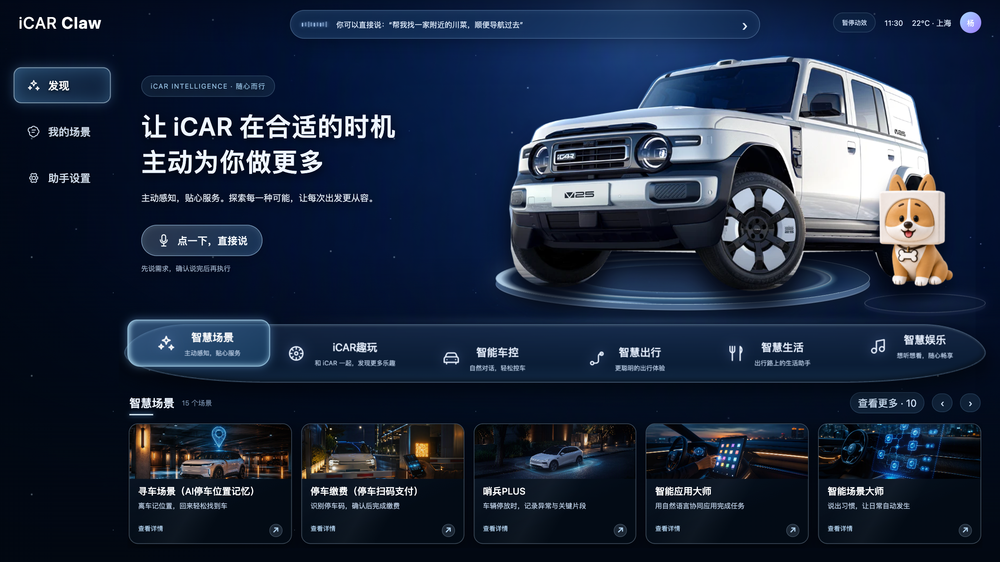
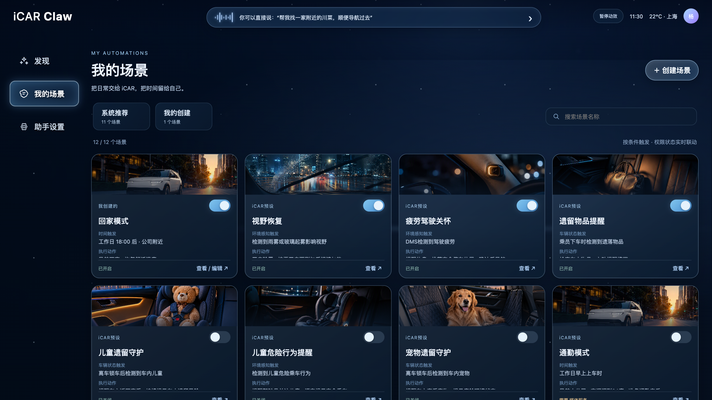
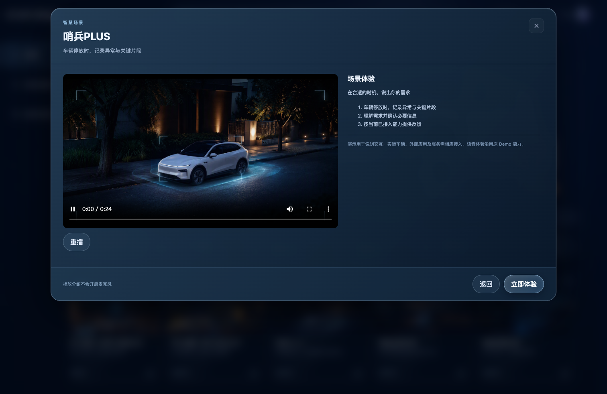
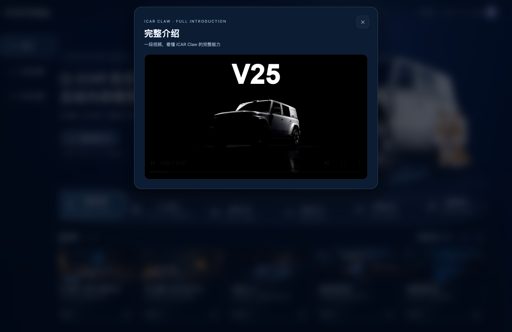

# iCAR超级APP-KIMI 3.0

**在线演示：<https://yuyangyoung1023-alt.github.io/iCARSuperAPP3.0-KIMI/>**（GitHub Pages，免安装直接体验）

iCAR Claw 超级APP 3.0 的 KIMI 整改版：面向 iCAR V25 的智能座舱语音交互演示站，覆盖发现页六大场景分类、智能场景管理、助手设置全屏导航、独立 APP 场景虚拟跳转等完整链路。

纯静态站点（HTML + CSS + JS），无需构建，本地起服务即可完整体验。

## 快速开始

三种启动方式任选其一（均支持 HTTP Range，视频可正常播放）：

```bash
# 方式一：双击启动（macOS）
启动V3.command          # 打开 http://127.0.0.1:8767/

# 方式二：命令行
python3 run.py

# 方式三：开发预览（支持 --host/--port 转发）
python3 scripts/dev-server.py --port 7100
# 或 npm run dev
```

> 注意：必须用上述方式启动，不要用 `python3 -m http.server`——它不支持 Range 分段请求，Chrome 会无法播放 MP4 视频。

## 主要功能

- **发现页**：六大场景分类（智能 / 娱乐 / 出行 / 生活 / 趣味 / 更多），切换时车模与卡基狗执行复合动效（车模三套动作 + 灯光闪烁，狗狗跳起扑食），卡片交错入场、展台脉冲、展厅扫光。
- **完整介绍视频**：主视觉「查看完整介绍」弹出 16:9 视频弹窗，视频位 `assets/videos/intro.mp4`。
- **独立 APP 场景**：寻车（AI停车位置记忆）、停车缴费（停车扫码支付）、哨兵PLUS 三卡片「立即体验」为虚拟跳转——启动画面 → 模拟 APP 演示界面；详情页内嵌真实演示视频。
- **我的场景**：左侧「系统推荐 / 我的创建」来源卡片 + 右侧名称搜索；按 开启优先 → 使用频率 排序，开关切换完全静默并以 FLIP 动效挪位。
- **助手设置**：全屏五分类导航——我的记忆 / 我的智能代理（角色引擎）/ 语音与唤醒 / 账号 / 隐私与权限。
- **智能应用大师（MA）**：一次说出 10 个意图的语音体验链路完整保留。

## 整改记录

本版本相对 3.0 基线共完成八轮整改，详见 [CHANGELOG.md](CHANGELOG.md)：

1. 车模抠图修复（底部锚定，五种分辨率不裁切不悬空）+ 33 张高保真场景封面补齐
2. 我的场景重构（来源卡片 + 搜索 + 排序）/ 设置全屏导航 / 分类切换动效 / 素色背景
3. 开关静默 + 动效重做（39 路并行动画）
4. 动效节奏放慢到完整展示标准，狗狗替换为「跳起扑食」
5. 主视觉改「查看完整介绍」视频弹窗
6. 三独立 APP 场景改虚拟跳转
7. 接入完整介绍视频（成片）
8. 修复视频无法播放（自研 Range 静态服务器）

## 界面预览

| 发现页 | 我的场景 |
| --- | --- |
|  |  |

| 哨兵PLUS 详情（视频播放） | 完整介绍视频弹窗 |
| --- | --- |
|  |  |

## 目录结构

```
├── index.html            # 入口
├── assets/               # 样式 / 脚本 / 品牌素材 / 封面 / 视频
│   ├── v3.js, v3.css     # 3.0 主逻辑与样式
│   ├── covers/           # 33 张场景封面（高保真）
│   ├── brand/            # 车模抠图 / 卡基狗 / 背景
│   └── videos/           # 完整介绍 + 三场景演示视频
├── scripts/              # Range 静态服务器与预览启动器
├── qa/                   # 回归脚本与验收截图
├── run.py / 启动V3.command
└── sw.js                 # PWA 离线缓存
```

## 技术说明

- 无构建依赖，纯原生 HTML/CSS/JS，PWA 离线缓存（`sw.js`）。
- 自带支持 HTTP Range（206 Partial Content）的静态服务器 `scripts/range_server.py`，保证 Chrome 下 MP4 正常播放。
- 回归测试基于 Playwright：`node qa/kimi-video-fix-check.cjs`（视频链路）、`node qa/kimi-r3-check.cjs`（动效与交互）。
